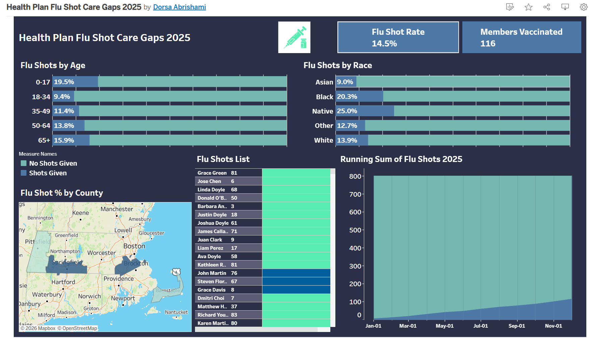

# Health Plan Flu Shot Care Gaps (Measurement Year 2025)

## Business Question

A health plan wants to know which members are missing their annual flu shot, and where to focus outreach to close those gaps.

Preventive care measures like flu vaccination affect member health and a plan's quality ratings. This project identifies eligible members, measures the 2025 flu shot rate, breaks it down by age, race, and county, and produces a member level list the plan could use for outreach.

## Key Results

* **801** members were eligible for a flu shot in 2025.
* **116** of them received a flu shot.
* **685** members are missing their flu shot.
* The overall flu shot rate is **14.5%**.

**Flu shot rate by age group**

* Ages 0 to 17: 19.5%
* Ages 18 to 34: 9.4%
* Ages 35 to 49: 11.4%
* Ages 50 to 64: 13.8%
* Ages 65 and older: 15.9%

**Flu shot rate by race**

* Asian: 9.0%
* Black: 20.3%
* Native: 25.0% (only 24 members, so one more or one fewer vaccination moves this rate by about 4 points; treat it with caution)
* Other: 12.7%
* White: 13.9%

**What this means:** coverage is low across every age group, so the plan has a large outreach opportunity. Adults 18 to 34 have the lowest rate and would be a natural first target.

## Dashboard



**Interactive version:** [View on Tableau Public](https://public.tableau.com/app/profile/dorsa.abrishami/viz/HealthPlanFluShotCareGaps2025/Dashboard1)

## Eligibility Rules

A member is counted as eligible if they:

* Had at least one encounter between January 1, 2023 and December 31, 2025, used as a proxy for active membership.
* Are alive, meaning they have no death date.
* Were at least 6 months old by December 31, 2025, following the CDC guideline that everyone 6 months and older should get a flu shot every year.

A member counts as vaccinated if they have at least one flu shot (immunization code 140) during calendar year 2025.

**How vaccination is tracked**

`flu_shot_2025` is a binary column: it shows 1 if the member was vaccinated in 2025 and 0 if they were not. Every eligible member keeps a row, so unvaccinated members stay in the data as care gaps instead of disappearing. This one column powers the whole analysis:

* Adding up the column counts vaccinated members, since the 0s add nothing.
* Averaging the column gives the vaccination rate, because the average of 1s and 0s equals the share of 1s. Tableau uses this to calculate rates by age, race, and county.
* Filtering the column to 0 produces the outreach list of members who still need a flu shot.

**Why these choices**

* Every date in the analysis points to 2025, the most recent complete year in the data. 2026 is incomplete, and most flu shots happen in the fall, so measuring it would make rates look artificially low.
* Age is calculated as of December 31, 2025, not today. A member who turned 65 in 2026 was 64 during the measurement year and belongs in the 50 to 64 group.
* The active window looks back more than one year because healthy people often skip a doctor visit. Requiring a 2025 visit would drop the very members most likely to be missing their shot.
* Only the earliest flu shot per member is kept, so members with more than one shot in a year are not counted twice.

## How I Validated the Results

Before building charts, I wrote a separate summary query that calculates total eligible members, vaccinated members, missing members, and the overall rate directly in SQL. That gave me one trusted number (14.5%) to check the dashboard against. The Tableau age group rates fall between 9 and 20%, which fits around the overall rate. The "Flu Shots List" sheet also shows 801 rows, matching the eligible member count from SQL. I also checked the Native group directly in SQL (24 eligible, 6 vaccinated, 25.0%), which matched the dashboard and confirmed the group is too small for a reliable rate.

## Problems I Solved

* **The 6 month eligibility filter dropped members who should qualify.** The original filter, `extract(month from age(...)) >= 6`, reads only the months part of a person's age. A member who is 40 years and 4 months old returns 4, fails the check, and is wrongly excluded. I replaced it with `pt.birthdate <= date '2025-12-31' - interval '6 months'`. The `interval` subtracts 6 months from the end of the measurement year, giving June 30, 2025, so anyone born on or before that date was at least 6 months old by the end of 2025.

* **The rate showed 0, then 14 instead of 14.5.** PostgreSQL drops decimals when it divides one whole number by another. Multiplying by `100.0` instead of `100` forced decimal division and gave the correct result.

* **Filtering to vaccinated members gave a 100% rate.** The filter removed unvaccinated members from the denominator, so the rate compared vaccinated members to themselves. I removed the filter and used `sum()` on the 1/0 vaccination flag, which counts only the vaccinated members while keeping everyone in the total.

* **Bar lengths in Tableau did not match their labels.** The chart used two measures on a dual axis, and each axis scaled itself separately. The blue bar stretched its highest value (19.5%) across the full width as if it were 100%. Synchronizing the axes put both bars on the same 0 to 1 scale.

* **Dates in the query mixed 2022 and 2026.** The active window and age calculation used different reference dates than the measurement year. I aligned every date to 2025.

* **The "Flu Shots List" sheet showed 751 rows instead of 801.** I built the list on a calculated "Full Name" field, and Tableau merges rows with identical values, so different members who share the same full name collapsed into one row. Adding member ID to Rows kept every member on a separate row and brought the count back to 801. I then hid the ID header to keep the list clean, while the ID still keeps every member unique.

## Tools

* **PostgreSQL** for the analysis (CTEs, LEFT JOIN, CASE, aggregation)
* **DBeaver** as the SQL client
* **Tableau Public** for the dashboard
* **Synthea** synthetic patient data (no real patient information)

## Repository Structure

```
sql/
  flu_shot_care_gaps.sql       Member level query used as the Tableau data source
  overall_flu_shot_rate.sql    Summary query used to validate the dashboard
images/
  dashboard.png                Screenshot of the finished dashboard
notes.md                       Line by line explanation of the SQL logic
README.md
```

## About This Project

This project started from a YouTube tutorial on building a flu shot dashboard with SQL and Tableau ([link](https://www.youtube.com/watch?v=3TuayvU1kwU)). I extended it by:

* Reframing it as a health plan care gap analysis instead of a hospital report.
* Moving the measurement year to 2025 and aligning every date in the logic to that year.
* Correcting the 6 month eligibility filter.
* Adding a summary query to validate the dashboard numbers.
* Documenting each decision and the errors I found along the way.

## Next Steps

* Prioritize the outreach list by risk, starting with members 65 and older and young children.
* Count total flu shots given (not just vaccinated members) to see how many members received more than one.
* Compare the 2025 rate with earlier years to see whether coverage is improving.
